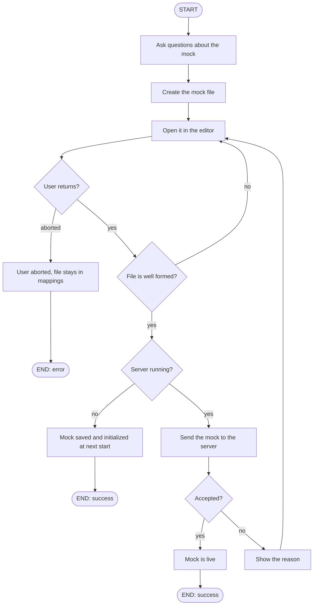

# Command: add

Guides you through creating a new mock and lets you review it in your editor.

## Workflow Overview

- The file is created directly in the active mocks folder. If you abort, it stays there. The next start or reload will fail on it, and you can fix it, disable it, or delete it manually.
- With the server running, it loads only the new mock. The other mocks are not touched.
- With the server stopped, it checks only the file format. The full check happens at the next start.
