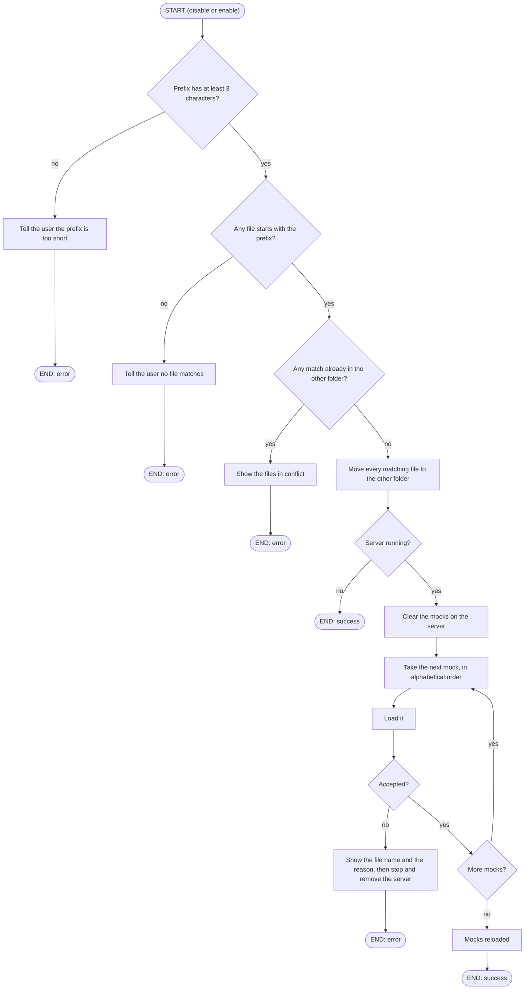

# Command: disable / enable

## disable \<prefix_file>

Switches off every mock whose file name starts with the prefix, without deleting them.

## enable \<prefix_file>

Switches back on every disabled mock whose file name starts with the prefix.

## Workflow Overview

- The prefix ignores case and is matched as plain text, so `*` is not a wildcard.
- `disable` looks in the active mocks, and `enable` looks in the disabled mocks.
- Every matching file is moved. If any of them already exists in the other folder, nothing is moved.
- `disable` also works while the server is stopped, so that you can switch off invalid mocks after a failed start.
