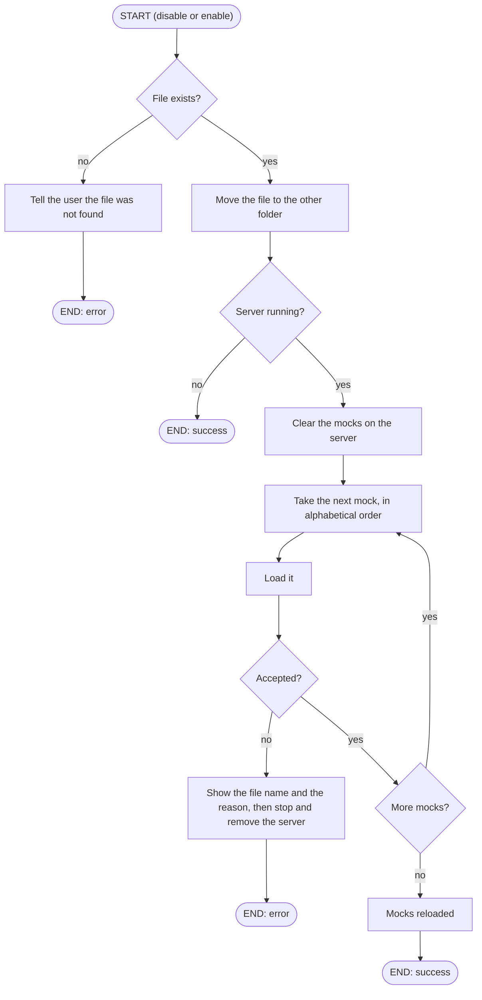

# Command: disable / enable

## disable \<file>

Switches a mock off without deleting it.

## enable \<file>

Switches a disabled mock back on.

## Workflow Overview

`disable` also works while the server is stopped, so that you can switch off an invalid mock after a failed start.
